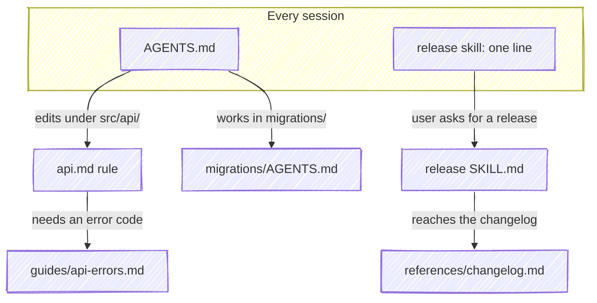

# Tiering guide

## Guidance is a tree

An agent doesn't need everything you know about a repo at once. It needs the
root at launch, and the rest as the work reaches it. Tiering gives guidance
that shape: a root every session loads, and branches that open only when
something calls for them. Each node holds just enough to act on at that depth,
plus a pointer for when more is needed.

Here's the guidance for an example repo, `acme-widget`. Only the top row is
paid for in every session:



| Node | Holds |
| --- | --- |
| `AGENTS.md` | what the repo is, how to build and test it |
| release skill, one line | when to use it |
| `api.md` rule | validate every input; the error codes are in `guides/api-errors.md` |
| `guides/api-errors.md` | the full table of error codes |
| `migrations/AGENTS.md` | never edit a migration that has run |
| release `SKILL.md` | the release steps |
| `references/changelog.md` | the changelog format |

A session that fixes a typo in the README pays for the top row and nothing
else. A session that adds an API endpoint opens the `api.md` rule, and opens
the error table only if it returns an error. Tiering a repo means pushing each
detail down to the deepest node that still opens when it's needed.

## Measuring the root

`cleat check` reports `launch-cost` when the root grows past the budget, and
names this guide by its path in the plugin. The `context-tiering` skill reads
it too, when you ask Claude to cut what your instructions cost. To see the
numbers yourself:

```bash
scripts/cleat cost .
```

It lists each file and listing entry a session loads at launch, with its tier
and size, and the total against the budget. It exits 1 past the budget, so it
can run in CI. The budget is 16 KiB unless you set your own:

```bash
git config cleat.launchBudget 12000
```

What follows is the guide as the agent reads it. Why each tier costs what it
does is in [Background](/background).

---

[`guides/tiering`](guides/tiering.md ':include')
