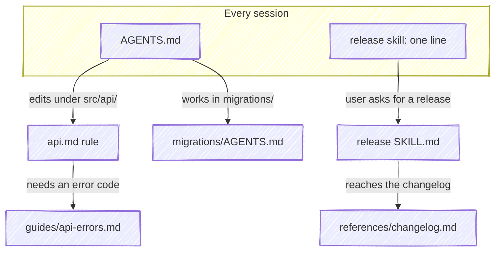

# Tiering guide

## Guidance is a tree

An agent doesn't need everything you know about a repo at once. It needs the
root at launch, and the rest as the work reaches it. Tiering gives guidance
that shape: a root every session loads, and branches that open only when
something calls for them. Each node holds just enough to act on at that depth,
plus a pointer for when more is needed.

Here's the guidance for an example repo, `acme-widget`. Only the top row is
paid for in every session:



| Node | Holds |
| --- | --- |
| `AGENTS.md` | what the repo is, how to build and test it |
| release skill, one line | when to use it |
| `api.md` rule | validate every input; the error codes are in `guides/api-errors.md` |
| `guides/api-errors.md` | the full table of error codes |
| `migrations/AGENTS.md` | never edit a migration that has run |
| release `SKILL.md` | the release steps |
| `references/changelog.md` | the changelog format |

A session that fixes a typo in the README pays for the top row and nothing
else. A session that adds an API endpoint opens the `api.md` rule, and opens
the error table only if it returns an error. Tiering a repo means pushing each
detail down to the deepest node that still opens when it's needed.

## Measuring the root

`cleat check` reports `launch-cost` when the root grows past the budget, and
names this guide by its path in the plugin. The `context-tiering` skill reads
it too, when you ask Claude to cut what your instructions cost. To see the
numbers yourself:

```bash
scripts/cleat cost .
```

It lists each file and listing entry a session loads at launch, with its tier
and size, and the total against the budget. It exits 1 past the budget, so it
can run in CI. The budget is 16 KiB unless you set your own:

```bash
git config cleat.launchBudget 12000
```

## Seeing the rest of the tree

The root is only what loads up front. A skill's body, the guides it points to,
and the scripts it runs load later, and they're where a session's cost grows
without anyone measuring it. `cleat graph` walks the whole tree a session can
open, across the repo, your user scope, and every enabled plugin, and gives
each node two numbers:

- **Reach cost**, what a session has already paid by the time the node opens.
- **Closure cost**, the node plus everything it pulls in. This is the branch
  you'd remove by splitting a skill, filtering a plugin, or trimming a guide.

```bash
scripts/cleat graph .
```

It opens a two-pane browser in the terminal, starting with **insights**: what
stands out in your setup, such as the type of file taking the biggest share of
launch, the skill that pulls in the most, a guide many skills share, or files
copied byte for byte. Select one to see the files it names. The left pane rolls everything up
by kind (instructions, rules, skills, plugins, hooks), each with what it costs
at launch and what it pulls in; open a row with enter or space. The right pane
shows the heaviest files under the selected row, or the tree a selected skill
or rule opens. Every row is colored from gray to red by what it pulls in, so
the hotspots stand out. Press `g` to roll up by owner instead.

Costs are in tokens, estimated at about 2.8 bytes each (what `/context` reports
for instruction files). A meter across the top shows what loads at start
against the 200k and 1M context windows, and each row a bar and what it pulls in. Press
`d` for every column; each row in the tree then answers four questions:

| Column | What it tells you |
| --- | --- |
| spent | What the session has already paid to get here, down the path you opened |
| this | What opening this file costs |
| +next | What opening it one level further adds |
| all | Everything it pulls in, each file once |

A skill that another one invokes is counted at its own row rather than added to
the caller's `+next` and `all`: invoking it is a separate step.

The strip under the panes says when the selected file loads, and which line
opens it. A rule waiting on `**/*.yml` loads only when such a file is touched,
and is tagged `[**/*.yml]` in the list; one whose globs match nothing here is
tagged `[retired]`. A guide loads when the agent follows the reference to it,
shown as the file and line holding it, such as
`SKILL.md:42  See the [forge cookbook](guides/forge-cookbook.md)`.

Narrow it with `--plugin`, `--marketplace`, `--scope`, or `--tier`. `--json`
gives the data to a script of your own.

`--html` opens the same graph as a page in your browser, as a radar; from the
terminal browser, `w` opens what you're looking at there, filter and probe
term included. The home button at the page's top left takes you back to
where it opened. Launch
sits at the center, and every other file sits as far out as the context a
session spends to reach it, in a wedge for the plugin or scope it comes from.
Files that only open on a condition (a glob, a hook, a typed command) are drawn
dashed. Each web address a file names is a site on the perimeter, drawn red: a
session reaches it only online, which is slower, less certain, and needs a
network. To review those external dependencies on their own, click Web
addresses on the radar or the perimeter itself, or press `e` in the terminal:
each host, what following it costs, and the files that send a session there.

Past a horizon sit the **orphans**, as hollow quatrefoils (the mark military
symbology gives an unknown contact): files beside your
guidance that nothing links to, so no session ever reads them. A file counts
when it sits in a skill's or agent's own folder, or in a folder a skill,
rule, or instruction file already links into, such as `guides/`. A README is
for people, and a file a hook's script prints reaches the agent through the
hook, so neither counts. Each orphan comes with where to name it: the line a
reachable file already spends on the same thing, or the line where its skill
names only its folder (`examples/`), so an agent has to list the folder to
find it. Where nothing a session reaches talks about it, link it from the
skill beside it, or delete it. The panel lists the heaviest orphans with
what loads at start, and `Orphans` in the terminal browser lists them all.

The meter under the radar runs out to a 1M context window, with a line where
a 200k window ends. It opens filled with
what loads at start, and the radar lights only those files. Ask about a term,
say `release`, and the meter fills on with what that prompt opens: the loaded
files that mention it light up, and following their references lights what an
agent wanting more would reach, hop by hop. Drag the meter back to watch the
hops go dark one at a time. The meter's red, hatched end is going online: each
web address the lit files name, counted at an estimate of what WebFetch hands
back. `cleat graph --measure-remote` measures each page, and keeps what it
found for 30 days, so you can see what reading one raw would cost and which
links no longer answer. Files that mention the term but that nothing lit
leads to are **islands**, past the horizon. Select one to see why: either a
lit file links a file that links it, and that lit line never says the term
(say it there, and both light), or only files the term never opens link it.
`p` does the same in the terminal browser, rolling the
left pane up by distance, and `--probe TERM --json` carries it to a script.

Every view reports three numbers, because each answers a different question:

| Number | What it answers |
| --- | --- |
| At launch | What every session pays before you type |
| Deepest path | What a session spends to reach the farthest file, one path at a time |
| Every file | What reading everything a session could reach would cost |

The panel beside the radar says what to look at first: what launch is made of
and the fixes that save the most, or the heaviest files a prompt reaches.
Click a wedge to see that owner's numbers, and double-click it to see it
alone. Esc, or your mouse's back button, steps back one view at a time.
Filters, insights, and each owner's scorecard sit behind Filters and
findings.

What follows is the guide as the agent reads it. Why each tier costs what it
does is in [Background](/background).

---

[`guides/tiering`](guides/tiering.md ':include')
